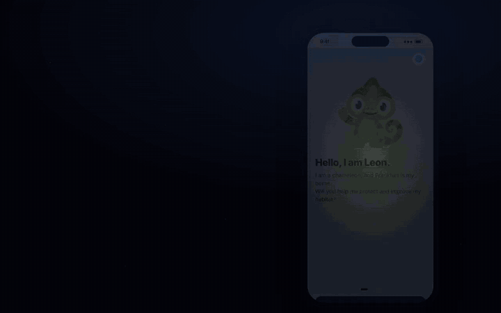

<h1 align="center">GeMainsam</h1>

<p align="center">
  <b>Sustainable everyday choices in Frankfurt, easy to find, easy to do and easy to see.</b><br>
  🥈 2nd place at the FES Hackathon 2026, Frankfurt Impact Challenge. Built in 24 hours by a team of six.
</p>

<p align="center">
  <a href="docs/media/gemainsam-demo.mp4">
    
  </a>
  <br>
  <sub>Click the preview to watch the full demo video</sub>
</p>

---

## The idea

Frankfurt already has a lot of good offers for a greener everyday life. Buses and trains, reusable cups, food-sharing shelves and neighbourhood clean-ups. The problem is that they live in different apps, websites and flyers, and nobody sees what their own effort adds up to.

**GeMainsam** brings them into one app. It shows what is nearby, checks that something really happened and makes the effect visible. Leon, a chameleon, guides you through it. The name mixes *gemeinsam* (together) with the river *Main*.

## What you can do

| | |
| --- | --- |
| 🚌 **Ride** | Start a bus or train ride on purpose, by NFC tag or check-in, and see the CO₂ you saved compared with the car. Mobility data from Transdev and traffiQ. |
| 🥕 **Save food** | Find food-sharing shelves on the map. Take a photo of a shelf or describe it out loud, and the AI lists what is inside. Pick-ups are confirmed with a short-lived QR code or a four-digit PIN. Data from foodsharing. |
| ♻️ **Reuse** | Borrow a Vytal reusable container by scanning its code, and report damage right in the app. |
| 🧹 **Clean up** | Join an FES clean-up. Two people confirm each other on site with a one-time QR code, and before and after photos come with time and location checks. |
| 🌍 **See the impact** | Weekly progress, a shared city goal and a globe that shows what Frankfurt achieved together. |

## Fair by design

One of the jury criteria was protection against perverse incentives, so the points system follows a few hard rules.

- **Points and impact are separate.** Impact is physics (kg CO₂e, kg of food). Points are a capped, degressive reward for the decision, never for distance or quantity.
- **No leaderboard as the main motor.** Cooperative goals and progress against your own last week instead.
- **Proof level is visible.** Confirmed, plausible, weakly plausible and self-reported actions earn different shares of the points.
- **Every point has a "why".** A sheet shows status, formula, factor and source for each credit.
- **Server-checked handovers.** QR codes and PINs are single use, expire after a few minutes and count once per person and action.

The full model is in [`konzept/02-PUNKTE-UND-ANTI-FEHLANREIZ.md`](konzept/02-PUNKTE-UND-ANTI-FEHLANREIZ.md) (German).

## Built with

- **App** Expo SDK 57, React Native, TypeScript, expo-router, zustand
- **Maps and scanning** Leaflet with routes on the map, expo-camera for QR codes, react-native-nfc-manager
- **AI** Gemini or OpenAI for photo and voice capture, with manual entry as a fallback
- **Server** Node.js trust server with SQLite for accounts, handovers, reuse and ratings
- **Languages** German, English, Turkish, Arabic, Croatian, Italian and plain German (Leichte Sprache)
- **Tests** node:test for the trust server, photo proofs, translations and the AI adapter

## Run it locally

You need Node 22.18 or newer, npm and the Expo Go app with SDK 57. Phone and computer have to be on the same private Wi-Fi or hotspot.

```bash
cd apps/mobile
npm ci --include=optional
cp .env.example .env    # optional, add an AI key for photo and voice capture
npm run dev:lan         # starts the trust server and Expo together
```

Scan the QR code with your phone camera and open it in Expo Go. On iOS, allow Expo Go to access the local network. Without an AI key, food can still be added by hand.

Run all checks with:

```bash
npm run check
```

## Repository

| Folder | What is inside |
| --- | --- |
| [`apps/mobile/`](apps/mobile/) | The app (iOS, Android and web) |
| [`apps/trust-server/`](apps/trust-server/) | Local server for accounts, handovers, reuse and ratings |
| [`konzept/`](konzept/) | Review, decisions and the points model |
| [`docs/`](docs/) | Requirements, contracts, demo script, [hackathon notes](docs/HACKATHON-NOTES-de.md) and the organizers' [data documentation](docs/HACKATHON-DATA-de.md) |
| `Foodsharing API/`, `Mobilitätsdaten/` | API docs and sample data from the partners |
| `shared/`, `tests/`, `tools/` | An earlier Python integration demo, not the app |

## Good to know

This is a 24-hour hackathon prototype. Some map, traffic and offer data are demo data and are labelled as such in the app. Vytal accounts and FES confirmations are not connected to the real partner systems yet. The partner API keys were issued by the organizers for the event and are not part of this repository.

## Team

Built by Team 01 at the FES Hackathon 2026 in Frankfurt, organised by [FES Frankfurter Entsorgungs- und Service GmbH](https://www.fes-frankfurt.de/), with data and APIs from Transdev, traffiQ, Vytal and foodsharing.

The people behind the code are in the [contributors list](../../graphs/contributors).
